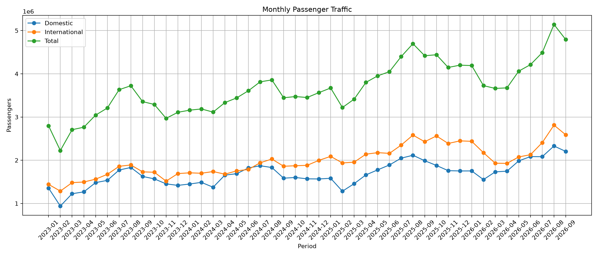
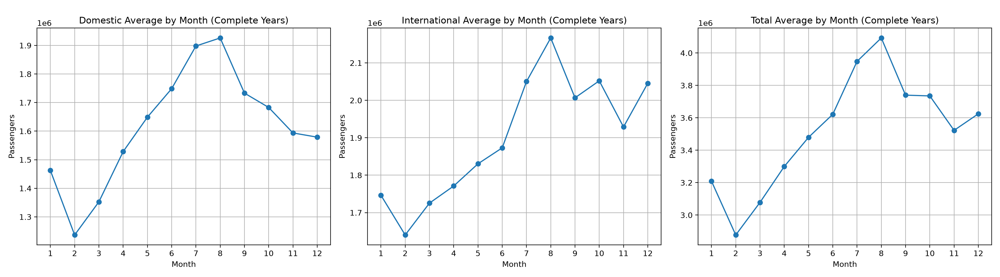
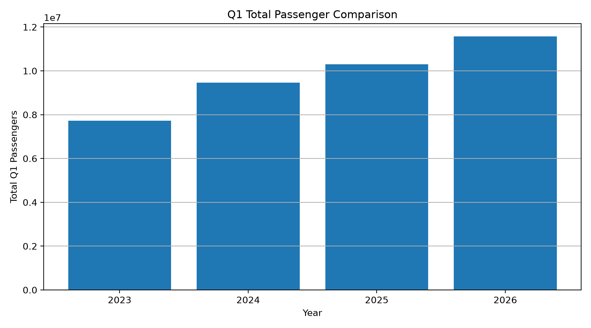
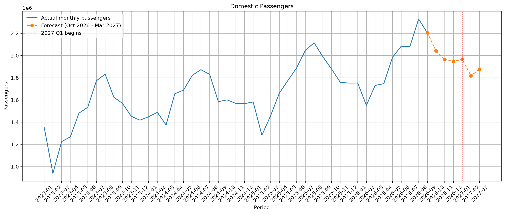
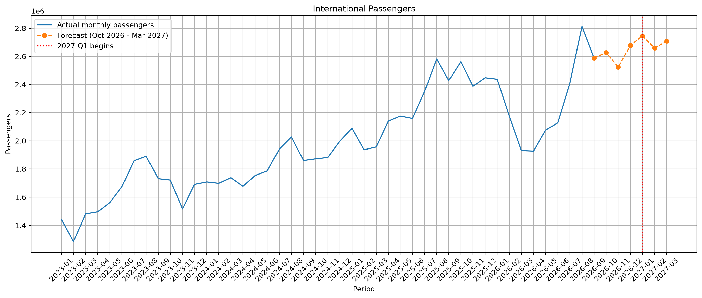
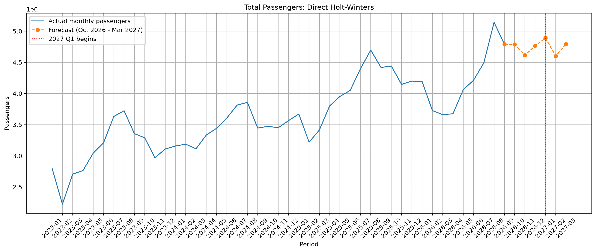
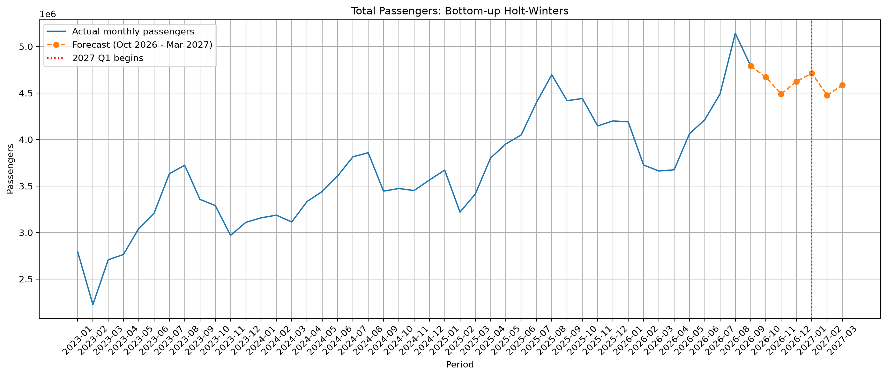

# İstanbul Sabiha Gökçen Yolcu Trafiği Tahmini

Bu projede İstanbul Sabiha Gökçen Havalimanı’nın aylık iç hat, dış hat ve toplam yolcu sayıları incelenerek 2027 yılının ilk çeyreği için tahmin oluşturuldu.

Çalışmada 2023 Ocak–2026 Eylül arasındaki veriler kullanıldı. Son tahmin, 2026 Ekim–2027 Mart arasındaki altı aylık dönem için üretildi; asıl odak ise 2027 Ocak, Şubat ve Mart aylarıdır.

English version: [README_EN.md](README_EN.md)

Holt-Winters modeli 2027 Q1 için yaklaşık **14,28 milyon toplam yolcu** tahmin ediyor. Bu değer 2026 Q1 toplamının yaklaşık %23,4 üzerinde. 2026 Nisan–Eylül arasındaki yıllık büyüme ortalamasıyla oluşturduğum basit referans kontrolü ise yaklaşık 12,03 milyon veriyor. Bu fark, final tahminin iyimser tarafta olabileceğini gösteriyor; verilen değerler kesin sonuç değil, nokta tahminidir.



## Projenin amacı

Bu projede bir zaman serisi çalışmasını, veriyi okumaktan tahmine kadar baştan sona yapmayı denedim. Süreçte:

- ham Excel dosyalarını kontrol ettim,
- kümülatif yolcu sayılarını aylık değerlere dönüştürdüm,
- yalnızca Sabiha Gökçen’e ait satırları ayırdım,
- aylık ve yıllık yolcu hareketlerini inceledim,
- basit kıyaslama modelleri kurdum,
- modelleri geçmiş dönemlerde test ettim,
- son olarak 2027 Q1 tahmini oluşturdum.

Bu tahmin; havalimanı kapasitesi, personel planlaması veya genel talep hakkında fikir vermek için kullanılabilecek bir analizdir. Tek başına kesin bir operasyon kararı olarak değerlendirilmemelidir.

## Veri kaynağı

Veriler, Devlet Hava Meydanları İşletmesi’nin aylık yayımladığı havalimanı istatistiklerinden alınmıştır:

- [DHMİ İstatistikler](https://ssd.dhmi.gov.tr/Sayfalar/Istatistikler.aspx)

Veri seti 2026 Eylül ayına kadar olan dosyalardan oluşmaktadır. DHMİ’de yayımlanan veriler yeni aylar eklendikçe veya değerler revize edildikçe değişebilir; bu durumda temiz veri ve tahmin çıktıları yeniden üretilmelidir. Projeyi yeniden çalıştırmak için DHMİ sayfasından indirilen ham dosyalar `Data/` klasörüne konulmalı ve şu adlandırma biçimini izlemelidir:

```text
YYYY_MM.xlsx
```

Örneğin `2025_02.xlsx`. Dosyaların içinde `YOLCU` adlı sayfa bulunması ve bu sayfada İstanbul Sabiha Gökçen satırının yer alması beklenir.

## Veri hazırlama

DHMİ dosyalarındaki yolcu sayıları aylık değer değil, yıl içinde biriken kümülatif değerlerdir. Ayrıca aynı dosyalarda Türkiye’deki farklı havalimanları birlikte yer alır.

Bu nedenle hazırlama aşamasında şu işlemler yapıldı:

1. Her Excel dosyasının yıl ve ay bilgisi dosya adından alındı.
2. `YOLCU` sayfasından yalnızca `İstanbul Sabiha Gökçen` satırı seçildi.
3. İç hat, dış hat ve toplam kümülatif değerler çıkarıldı.
4. Aynı yıl içindeki ardışık kümülatif değerlerin farkı alınarak aylık yolcu sayısı hesaplandı.
5. Her yılın Ocak değeri, o yılın ilk kümülatif değeri olarak korundu.
6. Toplam aylık değer, iç hat ve dış hat aylık değerlerinin toplamı olarak kontrol edildi.
7. Dönem bilgisi `YYYY-MM` biçiminde oluşturuldu.

Hazırlanan temiz veri şu dosyaya kaydedilir:

```text
Processed_Data/monthly_passenger_data.csv
```

Kod ayrıca verinin beklenen yapıda olup olmadığını kontrol eder: her yıl Ocak ile başlıyor mu, aylar eksiksiz ve sıralı mı, değerler negatif mi, iç hat + dış hat toplama eşit mi.

## Neden 2023’ten başlanıldı?

Bu çalışmada başlangıç noktası olarak 2023 seçildi. Amaç, pandemi döneminin olağan dışı etkilerini doğrudan modele taşımadan, daha güncel ve karşılaştırılabilir bir dönem üzerinde çalışmaktı.

Bu seçim çalışmanın kapsamını sadeleştirdi; ancak veri miktarı 45 aylık gözlemle sınırlı kaldı. Bu nedenle sonuçlar uzun yıllara dayanan kesin bir talep modeli olarak değil, mevcut dönem desenlerine dayanan bir başlangıç tahmini olarak yorumlanmalıdır.

## Keşifsel analizde görülenler

Verinin genelinde şu özellikler öne çıktı:

- Yolcu trafiğinde yıllar boyunca genel bir yükseliş eğilimi vardır.
- Yaz aylarında, özellikle Ağustos ayında, yolcu sayıları yükselmektedir.
- İç hat serisini tahmin etmek daha kolay oldu: Holt-Winters MAPE değeri iç hatta %5,05, dış hatta %9,90’dır.
- Dış hat serisinde aylar arası değişim daha belirgindir; ancak bu gözlem yalnızca grafiğe değil, daha yüksek tahmin hatasına da dayanmaktadır.
- Şubat ayı toplam yolcu sayısı 2023 ve 2025’te Ocak’tan belirgin düşükken, 2024’te belirgin bir fark yoktur.
- Şubat ayının 28 veya 29 gün sürmesi, aylık toplamın düşük görünmesinin makul bir açıklamasıdır. Tamamlanmış yılların (2023–2025) ortalamasında Şubat’ın günlük toplam yolcu sayısı Ocak’ın yaklaşık %98’i kadardır; fakat bu oran yıllara göre değişmektedir. Kodun kaydettiği oranlar 2023 için %88,1, 2024 için %107,9 ve 2025 için %97,1’dir. Bu yüzden gün sayısı açıklamasını kesin bir neden olarak değil, güçlü bir olasılık olarak yorumluyorum.
- Dış hatlarda bazı aylardaki değişimlerin nedenini yalnızca bu veri setinden kesin olarak açıklamak mümkün değildir.

Şubat düşüşünde takvim uzunluğunun yanında tatil dönemleri, hava koşulları, bilet fiyatları veya seyahat talebi de rol oynayabilir. Bu değişkenler veri setinde bulunmadığı için bunların etkisini ayrıca ölçmedim.



Bu grafik yalnızca tamamlanmış yılların ortalamaları kullanılarak oluşturulmuştur. Böylece 2026 yılının Eylül ayında bitmesinden dolayı Ekim–Aralık aylarının eksik kalması, mevsimsellik ortalamasını doğrudan bozmasın diye dikkate alınmıştır.

## Kullanılan tahmin modelleri

### 1. Seasonal Naive

Bu model bir ay için geçen yılın aynı ayındaki değeri tahmin olarak kullanır:

```text
Tahmin(t) = Gerçek değer(t - 12 ay)
```

Bu yöntem basit bir mevsimsel kıyaslama noktasıdır. Daha karmaşık bir modelin gerçekten işe yarayıp yaramadığını görmek için gereklidir.

### 2. Growth-adjusted Seasonal Naive

Bu model, geçen yılın aynı ayındaki değeri, o ayın bir önceki yıla göre büyüme oranıyla ayarlar. Bu, standart bir yöntem değil, kendi tanımladığım basit bir varyanttır:

```text
Tahmin = Geçen yılın aynı ayı × (1 + beklenen büyüme oranı)
```

Model karşılaştırmalarda tutuldu; ancak final 2027 tahmininde kullanılmadı. Bunun nedeni, özellikle dış hat Q1 karşılaştırmasındaki avantajının yalnızca altı gözleme dayanması ve genel ortak dönem karşılaştırmasında Holt-Winters’tan daha iyi sonuç vermemesidir.

### 3. Holt-Winters

Holt-Winters modeli şu özelliklerle kuruldu:

- toplamsal trend (`trend="add"`),
- toplamsal mevsimsellik (`seasonal="add"`),
- 12 aylık mevsimsel dönem (`seasonal_periods=12`),
- smoothing parametrelerinin model tarafından optimize edilmesi.

Bu model, serinin seviyesini, trendini ve yıllık mevsimsel hareketini birlikte kullanır. Final tahmini üretilmeden önce model, Ocak 2023–Eylül 2026 arasındaki tüm mevcut verilerle yeniden eğitildi.

## Model değerlendirme yöntemi

Model karşılaştırmasında rastgele train/test bölmesi kullanılmadı. Zaman serilerinde gelecekteki bilgiyi geçmişe taşımamak için eğitim dönemi her zaman test döneminden önce tutuldu.

Holt-Winters için iki tarihsel test yapıldı:

- **2025 testi:** Ocak 2023–Aralık 2024 arasındaki 24 aylık veriyle eğitildi ve 2025 yılı test edildi.
- **2026 testi:** Ocak 2023–Aralık 2025 verileriyle eğitildi ve mevcut 2026 ayları, yani Ocak–Eylül 2026 test edildi.

Bu iki testin birleştirilmesiyle ortak dönem karşılaştırması Ocak 2025–Eylül 2026 arasını kapsar. Q1 karşılaştırması ise 2025’in ilk üç ayı ile 2026’nın ilk üç ayını, toplam altı ayı kapsar.

Burada backtest ile final tahmin ufku aynı değildir. Backtest, geçmişteki hedef yılları değerlendirmek için kullanılır. Q1 backtest’inde model Aralık ayındaki eğitim verisinden sonra yalnızca bir ila üç ay ileriye tahmin yapmıştır. Final tahminde ise model Eylül 2026’da durdurulmuş ve Ekim 2026’dan Mart 2027’ye kadar altı ay ileriye tahmin yapılmıştır; bu nedenle 2027 Q1 ayları dört ila altı ay ileridedir. Bu yüzden backtest’teki düşük hata değerleri, final tahmin ufkunda aynı performansın kesin garantisi değildir.

Kullanılan hata ölçüleri:

- **MAE:** Tahmin hatalarının mutlak değerlerinin ortalaması. Yolcu cinsindendir.
- **MAPE:** Hatanın gerçek değere oranının yüzde olarak ortalaması.
- **Mean error:** İşaretli ortalama hata. `Gerçek - Tahmin` olarak hesaplanır. Negatif değer modelin ortalama olarak fazla tahmin ettiğini, pozitif değer ise eksik tahmin ettiğini gösterir.

## Ortak dönem sonuçları

Ortak dönem Ocak 2025–Eylül 2026 arasındadır.

| Seri | Model | MAE | MAPE | Ortalama hata |
|---|---|---:|---:|---:|
| İç hat | Holt-Winters | 88.143 | %5,05 | -7.021 |
| İç hat | Seasonal Naive | 179.151 | %9,79 | 159.609 |
| İç hat | Growth-adjusted | 227.589 | %13,55 | -24.337 |
| Dış hat | Holt-Winters | 214.123 | %9,90 | -150.789 |
| Dış hat | Seasonal Naive | 317.704 | %13,77 | 282.653 |
| Dış hat | Growth-adjusted | 324.628 | %14,38 | -76.358 |
| Toplam | Holt-Winters | 274.255 | %6,80 | -66.136 |
| Toplam | Growth-adjusted | 430.099 | %10,52 | -84.030 |
| Toplam | Seasonal Naive | 454.330 | %10,86 | 442.262 |

Bu daha geniş ortak dönem karşılaştırmasında Holt-Winters üç seri için de en düşük MAPE değerini verdi. Bu sonuç 2025-01–2026-09 arasındaki test dönemi için geçerlidir; 4–6 aylık final tahmin ufkunu doğrudan test etmez. Final model seçiminde tek bir kısa Q1 sonucundan çok, daha uzun ortak dönem performansına ağırlık verdim.

## Q1 sonuçları

Q1 karşılaştırması 2025 ve 2026’nın ilk üç aylarını kapsar.

| Seri | Model | MAE | MAPE | Ortalama hata |
|---|---|---:|---:|---:|
| İç hat | Holt-Winters | 87.062 | %6,12 | -51.629 |
| İç hat | Seasonal Naive | 188.666 | %12,14 | 120.270 |
| İç hat | Growth-adjusted | 308.281 | %22,10 | -78.860 |
| Dış hat | Growth-adjusted | 145.941 | %7,26 | -124.639 |
| Dış hat | Holt-Winters | 199.684 | %9,89 | -185.283 |
| Dış hat | Seasonal Naive | 241.444 | %11,37 | 232.943 |
| Toplam | Holt-Winters | 221.750 | %6,09 | -196.651 |
| Toplam | Seasonal Naive | 353.213 | %9,42 | 353.213 |
| Toplam | Growth-adjusted | 375.475 | %11,07 | -182.372 |

Dış hatlarda Q1 için en düşük MAPE Growth-adjusted modelde çıktı. Ancak bu sonuç yalnızca altı gözleme dayanmaktadır. Ortak dönem karşılaştırmasında Holt-Winters daha iyi performans göstermektedir. Bu nedenle dış hat final tahmininde Growth-adjusted model kullanılmadı; sonuç, alternatif bir benchmark olarak raporda tutuldu.

## Final 2027 Q1 tahmini

Final tahmin için Holt-Winters modelleri Ocak 2023–Eylül 2026 arasındaki tüm verilerle yeniden eğitildi. Önce 2026 Ekim–2027 Mart arasındaki altı ay tahmin edildi, ardından 2027 Q1 ayları ayrı bir tablo olarak alındı.

| Dönem | İç hat Holt-Winters | Dış hat Holt-Winters | Doğrudan toplam Holt-Winters | Bottom-up toplam |
|---|---:|---:|---:|---:|
| 2027-01 | 1.967.115 | 2.745.996 | 4.890.140 | 4.713.111 |
| 2027-02 | 1.817.930 | 2.658.826 | 4.599.936 | 4.476.756 |
| 2027-03 | 1.877.084 | 2.707.319 | 4.794.832 | 4.584.404 |

### Tahmin seviyesine ilişkin sağduyu kontrolü

Tahmin değerlerinin yüksek görünmesi tek başına bir kod hatası değildir; ancak mutlaka kontrol edilmesi gereken bir bulgudur. 2027 Q1 tahminleri 2026’nın aynı aylarıyla karşılaştırıldığında şu değişimler oluşur:

| Dönem | İç hat artışı | Dış hat artışı | Doğrudan toplam artışı |
|---|---:|---:|---:|
| 2027-01 / 2026-01 | %12,3 | %12,6 | %16,7 |
| 2027-02 / 2026-02 | %17,2 | %22,3 | %23,4 |
| 2027-03 / 2026-03 | %8,5 | %40,2 | %30,9 |

Özellikle Mart 2027 dış hat tahmini, Mart 2026’nın yaklaşık %40 üzerindedir. Bu sonuç bir kod hatası olarak kabul edilip elle düşürülmedi; mevcut Holt-Winters çıktısı, trendin devam ettiği daha iddialı bir senaryo olarak korunmuştur.

Bir referans kontrolü olarak kod, 2026 Nisan–Eylül aylarının yıllık toplam yolcu büyüme oranlarını hesaplayıp ortalamasını alır. Bu ortalama yaklaşık %3,9’dur. Bu oran 2026 Q1 toplamına uygulandığında referans değer yaklaşık 12,03 milyon yolcu olur. Holt-Winters’ın 2027 Q1 doğrudan toplamı ise 14,28 milyon yolcudur; aradaki yaklaşık 2,25 milyonluk fark, final tahminin iyimser tarafta olduğunu gösteren önemli bir uyarıdır. Bu hesap ayrı bir tahmin modeli değil, yalnızca tahmin seviyesini kontrol etmek için kullandığım basit bir karşılaştırmadır.

Q1 backtest’inde toplam Holt-Winters mean error değeri -196.651’dir. Bu, modelin Q1 dönemlerinde ortalama olarak fazla tahmin etme eğilimi olduğunu gösterir. Bu yüzden 2027 Q1 tablosu kesin sonuç olarak değil, trendin devamı varsayımına dayanan bir nokta tahmin olarak yorumlanmalıdır.



## Doğrudan toplam ve bottom-up kontrolü

Toplam yolcu sayısı iki şekilde tahmin edildi:

1. Toplam seriye doğrudan Holt-Winters uygulanarak.
2. İç hat ve dış hat tahminleri ayrı ayrı üretilip toplanarak.

İki yöntem aynı sonucu vermek zorunda değildir. Çünkü doğrudan toplam modeli toplam serinin kendi seviyesini, trendini ve mevsimselliğini öğrenir. Bottom-up yöntemde ise iç hat ve dış hat serileri ayrı ayrı öğrenilir.

2027 Q1’de doğrudan toplam tahmini, bottom-up toplamdan toplamda 510.637 yolcu, yani bottom-up toplamın yaklaşık %3,7’si kadar daha yüksektir. Kod bu farkı her ay için `direct_minus_bottom_up` ve `direct_vs_bottom_up_pct` sütunlarıyla kaydeder; fark üç ayın tamamında aynı yöndedir. Bottom-up Q1 mean error değeri de -236.913’tür. Bu yüzden iki yöntemin birbirine yakın olması tek başına tahmin seviyesinin kesin olarak doğru olduğunu kanıtlamaz.

Final tabloda doğrudan toplam Holt-Winters tahmini ana toplam tahmin olarak tutuldu. Bottom-up sonuç ise tutarlılık kontrolü ve alternatif bakış olarak saklandı.

## Grafikler

Forecasting kodu aşağıdaki dört ana tahmin grafiğini üretir:

### İç hat yolcuları



İç hat serisinde genel yükseliş ve yıl içindeki mevsimsel hareket belirgindir. Backtest MAPE değeri %5,05 olduğu için bu seri için en güçlü sonuç alınan model Holt-Winters olmuştur.

### Dış hat yolcuları



Dış hat serisi daha dalgalıdır. Modelin 2027 Q1 tahmini Ocak’tan Şubat’a düşüp Mart’ta yeniden yükselir. Tahminin şekli mevsimsel bir hareket gösterse de, özellikle Mart ayındaki seviye artışı ayrıca kontrol edilmesi gereken daha iddialı bir sonuçtur.

### Toplam yolcular — doğrudan Holt-Winters



Toplam seri iç ve dış hatların birlikte oluşturduğu daha yüksek seviyeli seridir. Doğrudan toplam Holt-Winters modelinin ortak dönem MAPE değeri %6,80’dir.

### Toplam yolcular — bottom-up



Bu grafik iç hat ve dış hat tahminlerinin toplamını gösterir. Doğrudan toplam tahminiyle arasındaki fark, toplam seriyi tek başına modellemek ile bileşenleri ayrı modellemek arasındaki farkı görmemizi sağlar.

## Kapsam dışında bırakılan etkenler

Bu sürümde yolcu sayısını etkileyebilecek dış değişkenler modele eklenmedi. Bu bilinçli bir kapsam seçimidir; henüz öğrenmediğim ileri yöntemleri yalnızca kullanmış görünmek için eklemek yerine, temel zaman serisi sürecini anlamaya odaklandım. Örneğin:

- resmi tatiller ve bayramlar,
- Ramazan ve bayram dönemleri,
- hava koşulları,
- bilet fiyatları ve döviz hareketleri,
- uçuş sayısı ve havayolu kapasitesi,
- ekonomik koşullar,
- savaş, salgın veya diğer olağan dışı olaylar,
- Sabiha Gökçen dışındaki havalimanlarındaki değişimler.

Sonuçlar, dış etkenler hesaba katılmadan geçmiş yolcu desenlerinin devam edeceği varsayımına dayanır. İleride regresyon ve dış değişkenlerle çalışan SARIMA/SARIMAX yöntemlerini öğrendiğimde bayram ve takvim etkilerini ayrıca modele eklemeyi planlıyorum.

## Sınırlılıklar

- Veri seti yalnızca 45 aylık gözlem içeriyor.
- 2026 yılı Eylül ayında bitiyor; Ekim–Aralık gerçek değerleri bu sürümde henüz bulunmuyor.
- Q1 karşılaştırması yalnızca 2025 ve 2026 olmak üzere iki Q1 dönemine, toplam altı aya dayanıyor.
- 2025 Holt-Winters testi 24 aylık eğitim verisiyle yapıldı; bu nedenle sonuçlar daha uzun veri setlerine göre daha hassas olabilir.
- Final tahmin 2026 Eylül’den itibaren dört ila altı ay ileriye uzanıyor. Bu ufuk, backtest sonuçlarından daha zor bir tahmin problemidir.
- 2027 Q1 gerçekleşen değerleri henüz olmadığı için final tahminin gerçek performansı şu anda ölçülemiyor.
- Model tahmin seviyesini ve belirsizlik aralığını birlikte sunmuyor; verilen değerler nokta tahminidir.

2026 Ekim verisi DHMİ tarafından yayımlandığında ilk adım olarak 2026 Ekim tahmini ile gerçek değer karşılaştırılmalıdır. Ancak tek bir ayın tutması, dört ila altı ay ilerideki Q1 tahmininin tamamının doğru olduğunu göstermez. Bu nedenle Ekim’den Mart’a kadar her ayın tahmini, tahmin ufku belirtilerek ayrı ayrı takip edilmelidir.

## Çıktılar

Kod çalıştırıldığında analiz sonuçları şu klasörlere kaydedilir:

```text
Outputs/
├── Figures/
└── Tables/
```

Önemli dosyalar:

- `common_model_comparison.csv`: Ortak dönem model karşılaştırması.
- `q1_model_comparison.csv`: 2025 ve 2026 Q1 karşılaştırması.
- `final_forecast_2026-10_to_2027-03.csv`: Altı aylık final tahmini.
- `final_forecast_2027_Q1.csv`: Yalnızca 2027 Q1 tahminleri.
- `final_q1_growth_vs_2026.csv`: 2027 Q1 tahminlerinin 2026 Q1’e göre değişimi.
- `q1_reference_growth_check.csv`: 2026 Nisan–Eylül büyüme ortalamasıyla yapılan tahmin seviyesi kontrolü.
- `recent_total_yoy_growth.csv`: 2026 aylarının bir önceki yılın aynı ayına göre toplam büyümesi.
- `daily_average.csv`: Tamamlanmış yıllara göre aylık günlük ortalama yolcu sayıları.
- `february_january_daily_ratio.csv`: Yıllara göre Şubat günlük yolcu sayısının Ocak’a oranı.
- `bottom_up_q1_summary.csv`: Bottom-up toplam kontrolünün performansı.

## Projeyi çalıştırma

Gerekli kütüphaneler `requirements.txt` içinde sürümleriyle birlikte listelenmiştir:

```bash
pip install -r requirements.txt
```

Çalışma Python 3.14 ile geliştirildi. Farklı bir Python sürümünde kütüphane sürümlerinin uyumluluğu ayrıca kontrol edilmelidir.

Kodlar proje kök dizininden şu sırayla çalıştırılmalıdır:

```bash
python Code/00_exploration.py
python Code/01_data_preparation.py
python Code/02_exploratory_analysis.py
python Code/03_forecasting.py
```

İlk dosya ham Excel dosyalarının yapısını ve örnek kayıtları kontrol eder. İkinci dosya temiz aylık veri setini oluşturur. Üçüncü dosya betimsel analizleri ve grafikleri üretir. Son dosya model karşılaştırmalarını, backtest sonuçlarını, final tahminleri ve forecasting grafiklerini oluşturur.

## Proje yapısı

```text
Havayolu Projesi/
├── Code/
│   ├── 00_exploration.py
│   ├── 01_data_preparation.py
│   ├── 02_exploratory_analysis.py
│   ├── 03_forecasting.py
│   └── archive/
│       └── 03_forecasting_old.py
├── Data/
│   └── YYYY_MM.xlsx
├── Processed_Data/
│   └── monthly_passenger_data.csv
├── Outputs/
│   ├── Figures/
│   └── Tables/
├── README.md
├── README_EN.md
└── requirements.txt
```

`Code/archive/03_forecasting_old.py`, eski tahmin ufku mantığını içeren bir geliştirme sürümüdür ve güncel çalıştırma akışının parçası değildir. Ayrıntı için `Code/archive/README.md` dosyasına bakılabilir.

## Bu projeden ne öğrendim?

Bu, veri analizi ve veri bilimi alanındaki ilk projem. Daha önce videolardan izlediğim küçük kod parçalarıyla çalışıyordum; bu projede ilk defa daha uzun bir kodu baştan sona kurma, çalıştırma ve çıkan sonuçları yorumlama aşamasını gördüm.

İlk başta DHMİ dosyalarındaki sayıların doğrudan aylık yolcu sayısı olduğunu düşünmüştüm. Sonra sayıların yıl içinde biriken kümülatif değerler olduğunu fark ettim ve aylık değeri hesaplamak için fark almam gerektiğini öğrendim. Bu yüzden veri hazırlama kısmı, tahmin modelinden önce çözülmesi gereken en önemli adımdı.

Tahmin ufkuyla ilgili de önemli bir hata yaptım. İlk sürümde `forecast(3)` kullanıp çıkan değerleri 2027 Ocak–Mart tahmini olarak yorumlamıştım. Ancak modelin eğitim verisi 2026 Eylül’de bitiyordu; bu üç değer aslında 2026 Ekim–Aralık dönemine aitti. Daha sonra altı ay tahmin edip son üç ayı almam gerektiğini anladım. Bu hata, bir tahminin yalnızca sayılarından değil, hangi tarihlere ait olduğundan da kontrol edilmesi gerektiğini gösterdi.

Model karşılaştırırken tek bir MAPE değerine bakmanın yeterli olmadığını da gördüm. Dış hatlarda Growth-adjusted model Q1 için daha iyi görünse de bu sonuç yalnızca altı aya dayanıyordu. Ortak dönem sonuçlarını, tahminin şeklini ve tahmin seviyesini birlikte düşününce daha temkinli bir yorum yapmam gerektiğini fark ettim. Holt-Winters çıktısını değiştirmedim; ancak 2027 Q1 toplamının referans seviye kontrolünün üstünde kaldığını açıkça not ettim.

Projeyi geliştirirken yapay zekâ araçlarından kod yazma, açıklama, hata ayıklama ve düzenleme desteği aldım. Buna rağmen kullanılan yöntemleri anlamaya, kodu kontrol etmeye ve sonuçların yorumunu kendim yapmaya çalıştım. Bu nedenle bu proje yalnızca ortaya çıkan tahminlerden değil, veriyle çalışmayı öğrenme sürecimden de oluşuyor.

## Gelecek çalışmalar

- 2026 Ekim ve sonraki ayların gerçek değerleriyle tahmin takibini yapmak.
- Sönümlü trend seçeneğini (`damped trend`) ayrı bir alternatif olarak backtest etmek.
- Tamamlanmış yıllara dayalı daha uzun bir veri seti kullanmak.
- Rolling-origin backtest ile farklı tahmin ufuklarını daha ayrıntılı değerlendirmek.
- Bayram, tatil, hava durumu ve uçuş kapasitesi gibi dış değişkenleri eklemek.
- Regresyon ve SARIMAX yöntemlerini öğrenerek modeli geliştirmek.
- Tahmin aralıklarını hesaplamak.
