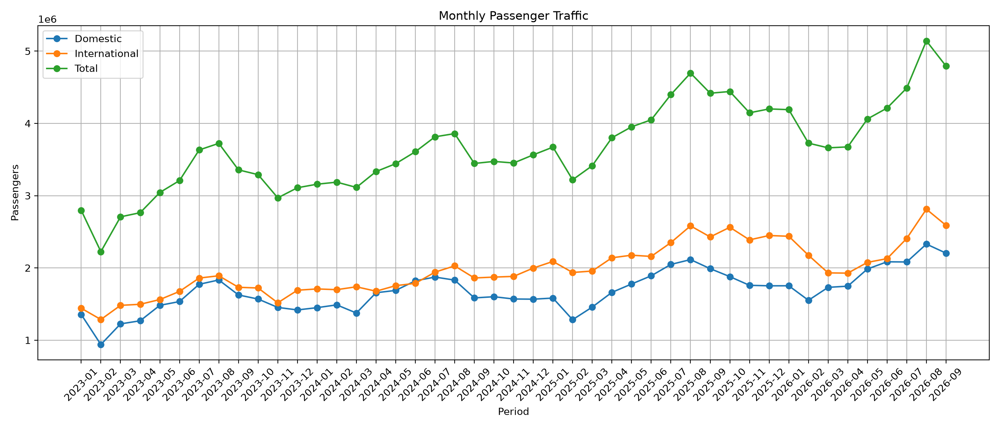
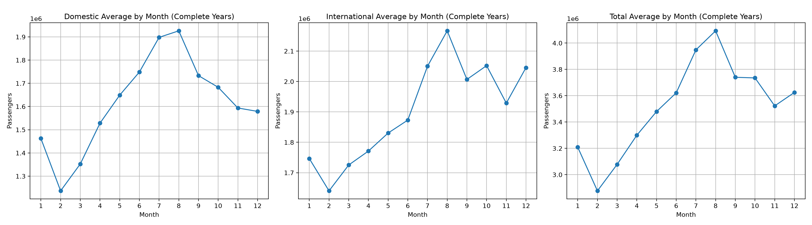
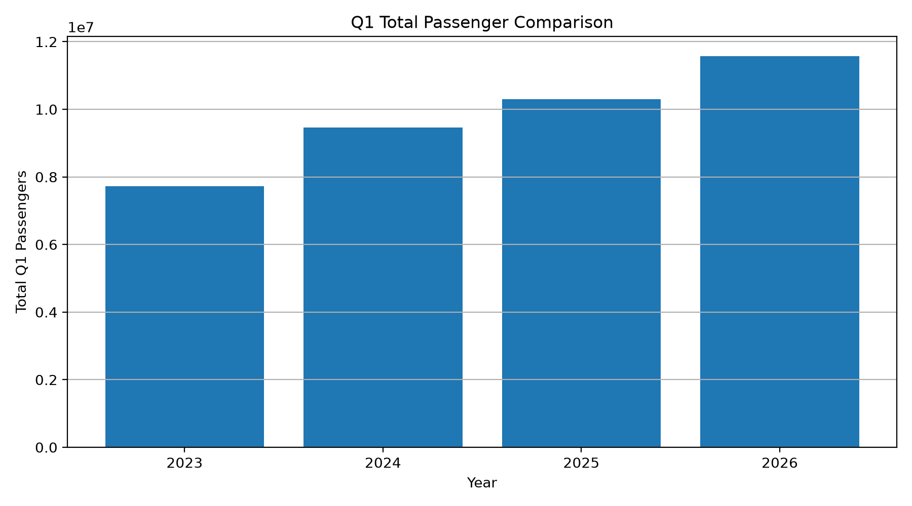
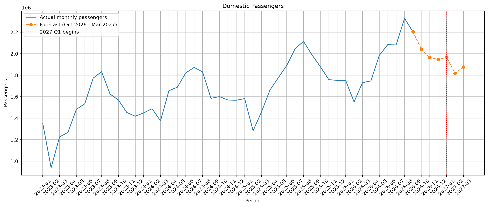
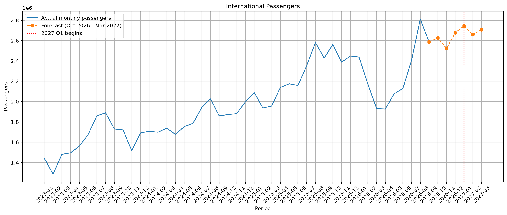
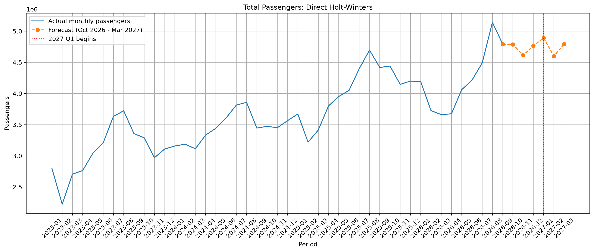
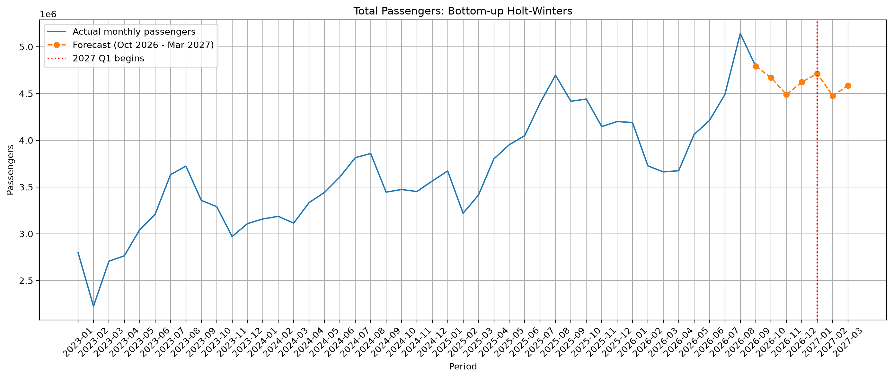

# Istanbul Sabiha Gökçen Passenger Traffic Forecast

This is my first data analysis and data science project. In this project, I study monthly passenger numbers at Istanbul Sabiha Gökçen Airport and make a forecast for the first quarter of 2027.

The analysis has three series:

- Domestic passengers
- International passengers
- Total passengers

I used data from January 2023 to September 2026. The final forecast covers October 2026 to March 2027. The main focus is January, February, and March 2027.

Turkish version: [README.md](README.md)

The Holt-Winters model forecasts about **14.28 million total passengers** for 2027 Q1. This is about 23.4% higher than the actual 2026 Q1 total. A simple reference check based on the average year-over-year growth from April to September 2026 gives about 12.03 million passengers. This difference suggests that the final forecast may be optimistic. These values are point forecasts, not certain results.



## Project purpose

I prepared this project to learn how a basic time series project works from beginning to end. I wanted to do more than create one forecast number. During the project, I:

- checked the raw Excel files,
- converted cumulative passenger numbers into monthly numbers,
- kept only the rows for Istanbul Sabiha Gökçen Airport,
- studied monthly and yearly passenger movements,
- created simple benchmark models,
- tested the models on past periods,
- created a forecast for 2027 Q1.

The forecast can give an idea about passenger demand and possible planning needs. It should not be used as the only source for an important operational decision.

## Data source

I downloaded the data from the monthly airport statistics published by the General Directorate of State Airports Authority (DHMİ):

- [DHMİ Statistics](https://ssd.dhmi.gov.tr/Sayfalar/Istatistikler.aspx)

The dataset ends in September 2026. DHMİ data may change when new months are published or previous values are revised. If this happens, the cleaned data and forecast outputs should be created again. To run the project again, the raw Excel files should be downloaded from the DHMİ website and placed in the `Data/` folder.

The file names must use this format:

```text
YYYY_MM.xlsx
```

For example:

```text
2025_02.xlsx
```

Each file should contain a sheet named `YOLCU`. This sheet should include a row for `İstanbul Sabiha Gökçen`.

## Data preparation

The passenger numbers in the DHMİ files are cumulative numbers. They show the total number of passengers from the beginning of the year. The files also contain different airports in Turkey.

I completed these steps:

1. I read the year and month from each Excel file name.
2. I selected only the `İstanbul Sabiha Gökçen` row from the `YOLCU` sheet.
3. I selected the cumulative domestic, international, and total values.
4. I calculated monthly values by taking the difference between consecutive cumulative values in the same year.
5. I kept the January value as the first monthly value of each year.
6. I checked that domestic passengers plus international passengers equal total passengers.
7. I created the period column in `YYYY-MM` format.

The cleaned data is saved here:

```text
Processed_Data/monthly_passenger_data.csv
```

The code also checks whether the data has the expected structure: each year starts with January, months are complete and ordered, values are not negative, and domestic plus international passengers equal total passengers.

## Why did I start with 2023?

I chose 2023 as the starting year because I wanted to work with a more recent and comparable period and avoid bringing the unusual pandemic period directly into the model.

This choice also means that the dataset has only 45 monthly observations. Therefore, the results should be seen as a first forecast based on recent patterns, not as a long-term demand model.

## Findings from the exploratory analysis

The data shows these main patterns:

- Passenger traffic has a general upward trend.
- Passenger numbers are usually higher in summer, especially in August.
- Domestic traffic was easier to forecast: the Holt-Winters MAPE was 5.05% for domestic passengers and 9.90% for international passengers.
- International traffic has larger month-to-month changes, and its forecast errors were higher.
- February total passengers were clearly lower than January in 2023 and 2025, but not in 2024.
- February has only 28 or 29 days. This is a reasonable explanation for a lower monthly total. In the average of the complete years from 2023 to 2025, February daily passengers were about 98% of January daily passengers. The yearly ratios were 88.1% in 2023, 107.9% in 2024, and 97.1% in 2025. I therefore treat the number of days as a strong possibility, not as a proven cause.
- The dataset alone cannot explain the exact reasons for every change in international traffic.

Weather, holidays, ticket prices, and travel demand may also affect the February result. These variables are not in this dataset, so I did not measure their separate effects.



This chart uses only complete years. Since 2026 ends in September, using complete years avoids mixing incomplete 2026 data with the other years in the monthly average.

## Forecasting models

### 1. Seasonal Naive

This model uses the value from the same month of the previous year:

```text
Forecast(t) = Actual value(t - 12 months)
```

It is a simple seasonal benchmark. It helps me see whether a more complex model really gives better results.

### 2. Growth-adjusted Seasonal Naive

This model adjusts the value from the same month of the previous year with the year-over-year growth observed for that month. It is not a standard named method; it is a simple variant that I defined:

```text
Forecast = Previous year's same-month value × (1 + expected growth rate)
```

I kept this model for comparison, but I did not use it for the final 2027 forecast. It performed well for international Q1, but this result used only six observations. In the longer common-period comparison, it did not perform better than Holt-Winters.

### 3. Holt-Winters

I used Holt-Winters with:

- an additive trend (`trend="add"`),
- additive seasonality (`seasonal="add"`),
- a 12-month seasonal period (`seasonal_periods=12`),
- optimized smoothing parameters.

This model uses the level, trend, and yearly seasonal movement of the series. For the final forecast, I fitted the model again with all available data from January 2023 to September 2026.

## Model evaluation

I did not use a random train/test split. For a time series, the model must not use future information when it learns the past. Therefore, every training period comes before its test period.

I used two historical Holt-Winters tests:

- **2025 test:** I trained the model with 24 months from January 2023 to December 2024 and tested it on 2025.
- **2026 test:** I trained the model with data from January 2023 to December 2025 and tested it on the available months of 2026, from January to September.

The common-period comparison covers January 2025 to September 2026. The Q1 comparison covers the first three months of 2025 and the first three months of 2026, so it uses six months in total.

The backtest horizon and the final forecast horizon are different. In the Q1 backtest, the model forecasts only one to three months ahead after the December training point. In the final forecast, the model stops at September 2026 and forecasts six months forward, from October 2026 to March 2027. The final Q1 values are therefore four to six months ahead. The low backtest errors do not guarantee the same performance at this longer horizon.

I used these error metrics:

- **MAE:** The average absolute error, in passengers.
- **MAPE:** The average absolute percentage error.
- **Mean error:** The signed average error, calculated as `Actual - Forecast`. A negative value means that the model usually forecast too high. A positive value means that it usually forecast too low.

## Common-period results

The common period is January 2025 to September 2026.

| Series | Model | MAE | MAPE | Mean error |
|---|---|---:|---:|---:|
| Domestic | Holt-Winters | 88,143 | 5.05% | -7,021 |
| Domestic | Seasonal Naive | 179,151 | 9.79% | 159,609 |
| Domestic | Growth-adjusted | 227,589 | 13.55% | -24,337 |
| International | Holt-Winters | 214,123 | 9.90% | -150,789 |
| International | Seasonal Naive | 317,704 | 13.77% | 282,653 |
| International | Growth-adjusted | 324,628 | 14.38% | -76,358 |
| Total | Holt-Winters | 274,255 | 6.80% | -66,136 |
| Total | Growth-adjusted | 430,099 | 10.52% | -84,030 |
| Total | Seasonal Naive | 454,330 | 10.86% | 442,262 |

Holt-Winters has the lowest MAPE for all three series in this longer comparison. This result applies to the tested period from January 2025 to September 2026; it does not directly test the four-to-six-month final horizon. I therefore gave more weight to the common period than to one short Q1 comparison.

## Q1 results

The Q1 comparison uses the first three months of 2025 and 2026.

| Series | Model | MAE | MAPE | Mean error |
|---|---|---:|---:|---:|
| Domestic | Holt-Winters | 87,062 | 6.12% | -51,629 |
| Domestic | Seasonal Naive | 188,666 | 12.14% | 120,270 |
| Domestic | Growth-adjusted | 308,281 | 22.10% | -78,860 |
| International | Growth-adjusted | 145,941 | 7.26% | -124,639 |
| International | Holt-Winters | 199,684 | 9.89% | -185,283 |
| International | Seasonal Naive | 241,444 | 11.37% | 232,943 |
| Total | Holt-Winters | 221,750 | 6.09% | -196,651 |
| Total | Seasonal Naive | 353,213 | 9.42% | 353,213 |
| Total | Growth-adjusted | 375,475 | 11.07% | -182,372 |

Growth-adjusted has the lowest Q1 MAPE for international passengers. However, this result is based on only six observations. Holt-Winters performs better in the longer common-period comparison, so I did not use Growth-adjusted for the final international forecast.

## Final 2027 Q1 forecast

For the final forecast, I fitted the Holt-Winters models again with all data from January 2023 to September 2026. First, I forecast six months from October 2026 to March 2027. Then, I selected the three 2027 Q1 months.

| Period | Domestic Holt-Winters | International Holt-Winters | Direct total Holt-Winters | Bottom-up total |
|---|---:|---:|---:|---:|
| 2027-01 | 1,967,115 | 2,745,996 | 4,890,140 | 4,713,111 |
| 2027-02 | 1,817,930 | 2,658,826 | 4,599,936 | 4,476,756 |
| 2027-03 | 1,877,084 | 2,707,319 | 4,794,832 | 4,584,404 |

### A sanity check for the forecast level

The high forecast values are not automatically a coding error, but they need a clear check. Compared with the actual values from 2026 Q1, the 2027 Q1 forecast changes as follows:

| Period | Domestic growth | International growth | Direct total growth |
|---|---:|---:|---:|
| 2027-01 / 2026-01 | 12.3% | 12.6% | 16.7% |
| 2027-02 / 2026-02 | 17.2% | 22.3% | 23.4% |
| 2027-03 / 2026-03 | 8.5% | 40.2% | 30.9% |

The March 2027 international forecast is about 40% higher than March 2026. I did not manually reduce this value. I kept the Holt-Winters result as a more optimistic scenario in which the recent trend continues.

As a reference check, the code calculates the year-over-year total growth for April–September 2026 and takes its average. The average is about 3.9%. Applying this rate to the 2026 Q1 total gives a reference value of about 12.03 million passengers. The direct Holt-Winters forecast for 2027 Q1 is 14.28 million, about 2.25 million higher. This difference is an important warning that the final forecast may be optimistic. This is not a second forecasting model; it is only a simple level check.

The Q1 Holt-Winters mean error for the total series is -196,651. This shows that the model tends to forecast too high in the Q1 backtest. Therefore, I present the 2027 Q1 values as point forecasts under the trend-continuation assumption, not as certain results.



## Direct total and bottom-up check

I forecast total passengers in two ways:

1. I fitted Holt-Winters directly to the total series.
2. I forecast domestic and international passengers separately and added them.

The two methods do not have to give the same result. The direct total model learns the level, trend, and seasonality of the total series. The bottom-up method learns these features separately for domestic and international passengers.

In 2027 Q1, the direct total forecast is 510,637 passengers higher than the bottom-up total. This is about 3.7% of the bottom-up total. The code saves this difference for every month in the `direct_minus_bottom_up` and `direct_vs_bottom_up_pct` columns. The difference has the same direction in all three months. The bottom-up Q1 mean error is also negative (-236,913), so two close forecasts do not prove that the forecast level is correct.

I use the direct total Holt-Winters result as the main total forecast. I keep the bottom-up result as a consistency check and an alternative view.

## Forecast charts

The forecasting script creates four main forecast charts.

### Domestic passengers



Domestic traffic shows a general increase and a clearer yearly pattern. Holt-Winters has a backtest MAPE of 5.05% for this series.

### International passengers



International traffic is more variable. The 2027 Q1 forecast falls from January to February and rises again in March. This seasonal shape is reasonable, but the high March level needs attention.

### Direct total Holt-Winters



The total series combines domestic and international traffic. The direct total Holt-Winters model has a common-period MAPE of 6.80%.

### Bottom-up total



This chart shows the sum of the separate domestic and international forecasts. The difference from the direct total chart shows the effect of modelling the total series directly or modelling its components separately.

## External factors not included

This version does not include external variables that may affect passenger numbers. This is a conscious scope choice. Since I am still learning these advanced methods, I focused on understanding the basic time-series process instead of adding a complex method only to make the project look more advanced. Examples of excluded factors are:

- public holidays and religious holidays,
- Ramadan and holiday periods,
- weather,
- ticket prices and exchange rates,
- number of flights and airline capacity,
- economic conditions,
- war, pandemics, or other unusual events,
- changes at other airports in Istanbul or Turkey.

The results assume that past passenger patterns continue and that these external effects are not included. I plan to learn regression and SARIMA/SARIMAX methods and add holiday or calendar variables in a future version.

## Limitations

- The dataset has only 45 monthly observations.
- 2026 ends in September, so the actual values for October–December are not in this version.
- The Q1 comparison uses only two Q1 periods, six months in total.
- The 2025 Holt-Winters test uses 24 months of training data.
- The final forecast looks four to six months into the future. This is a harder problem than the historical backtests.
- The actual values for 2027 Q1 are not available yet, so the final forecast cannot be evaluated today.
- The model gives point forecasts, not prediction intervals.

When DHMİ publishes the October 2026 data, I will first compare the October forecast with the actual value. However, one correct month does not prove that the full Q1 forecast is correct. I should track each month from October to March and record the forecast horizon for each comparison.

## Outputs

When the code runs, it saves the analysis results in these folders:

```text
Outputs/
├── Figures/
└── Tables/
```

Important files include:

- `common_model_comparison.csv`: Common-period model comparison.
- `q1_model_comparison.csv`: 2025 and 2026 Q1 comparison.
- `final_forecast_2026-10_to_2027-03.csv`: Six-month final forecast.
- `final_forecast_2027_Q1.csv`: 2027 Q1 forecast.
- `final_q1_growth_vs_2026.csv`: 2027 Q1 forecast growth compared with 2026 Q1.
- `q1_reference_growth_check.csv`: Forecast level check based on the average growth from April to September 2026.
- `recent_total_yoy_growth.csv`: Total year-over-year growth for the available 2026 months.
- `daily_average.csv`: Average daily passenger numbers by month for complete years.
- `february_january_daily_ratio.csv`: February daily passengers as a percentage of January, by year.
- `bottom_up_q1_summary.csv`: Bottom-up total check.

## How to run the project

The required package versions are listed in `requirements.txt`:

```bash
pip install -r requirements.txt
```

Run the scripts from the project root in this order:

```bash
python Code/00_exploration.py
python Code/01_data_preparation.py
python Code/02_exploratory_analysis.py
python Code/03_forecasting.py
```

The first script checks the raw Excel files. The second script creates the cleaned monthly data. The third script creates the descriptive analysis tables and charts. The last script compares the models, runs the backtests, creates the final forecasts, and saves the forecasting charts.

## Project structure

```text
Havayolu Projesi/
├── Code/
│   ├── 00_exploration.py
│   ├── 01_data_preparation.py
│   ├── 02_exploratory_analysis.py
│   ├── 03_forecasting.py
│   └── archive/
│       └── 03_forecasting_old.py
├── Data/
│   └── YYYY_MM.xlsx
├── Processed_Data/
│   └── monthly_passenger_data.csv
├── Outputs/
│   ├── Figures/
│   └── Tables/
├── README.md
├── README_EN.md
└── requirements.txt
```

`Code/archive/03_forecasting_old.py` is an old development version with the old forecast-horizon logic. It is not part of the current run order. See `Code/archive/README.md` for more information.

## What I learned from this project

This is my first project in data analysis and data science. Before this project, I mostly followed short videos and tried small pieces of code. Here, I saw for the first time how to build, run, check, and explain a longer analysis from beginning to end.

At first, I thought that the numbers in the DHMİ files were already monthly passenger numbers. Later, I understood that they were cumulative values during the year. I learned that I had to take differences to calculate the real monthly values. This showed me that data preparation can be more important than the forecasting model itself.

I also made an important mistake about the forecast horizon. In the first version, I used `forecast(3)` and thought that the results were the forecast for January–March 2027. However, the training data ended in September 2026, so these three values were actually for October–December 2026. I then understood that I needed to forecast six months and take the last three months for 2027 Q1. This taught me to check the dates of a forecast, not only the numbers.

I learned that one MAPE value is not enough for model selection. Growth-adjusted looked better for international Q1, but this result used only six months. I compared the common-period results, the forecast shape, and the forecast level together. I kept the Holt-Winters output, but I also wrote down that its 2027 Q1 total is above the reference level check.

During development, I used AI tools for code writing, explanations, debugging, and code organization. I still tried to understand why each method was used, check the code, and make the final interpretation myself. Therefore, this project is not only about the final forecasts; it also shows my learning process while working with data.

## Future work

- Compare the forecasts with the actual values for October 2026 and the following months.
- Test a damped trend as another Holt-Winters alternative.
- Use a longer dataset with more complete years.
- Use rolling-origin backtesting for different forecast horizons.
- Add holiday, weather, and flight-capacity variables.
- Learn regression and SARIMAX methods and improve the model.
- Calculate prediction intervals.
